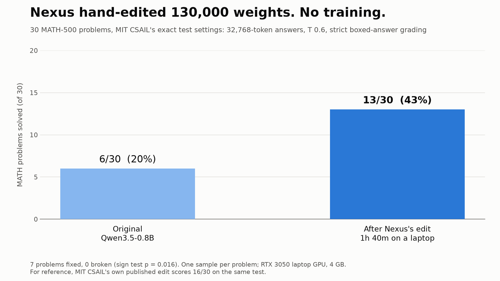

# Vibe surgery: Nexus edited Qwen3.5-0.8B's weights and doubled its math score

No training. No fine-tuning. Nexus read the model's own activations, found where it gets stuck in loops,
and changed 130,384 of its roughly 800 million weights with one line of tensor maths. It took 1 hour 40
minutes on a gaming laptop with a 4 GB GPU (RTX 3050).



| 30 MATH-500 problems, 32,768-token answers | Solved | Cut off still thinking |
|---|---|---|
| Original Qwen3.5-0.8B | 6 / 30 (20%) | 27 |
| **After Nexus's edit** | **13 / 30 (43%)** | 17 |
| For reference: MIT CSAIL's published edit | 16 / 30 (53%) | 6 |

Problem by problem, the edit fixed 7 answers and broke none (two-sided sign test, p = 0.016).

This repeats the idea in MIT CSAIL's
[Sparks of Weight-Space Programming](https://rikiyat.github.io/blog/weight-space-programming/), where an AI
agent edited this same model. Nexus worked from that write-up's description (layers 15 and 19, 64 columns
each), found its own direction from the model's activations, and never used MIT's code or edited weights.
MIT's edit is still stronger.

## Check it yourself

**Just want the model?** It's on Hugging Face: [theyashhambarde/Qwen3.5-0.8B-vibe-surgery](https://huggingface.co/theyashhambarde/Qwen3.5-0.8B-vibe-surgery). Use it with thinking on and long outputs.

**1. Rebuild the edited model** from the original weights (seconds, CPU is fine):

```bash
cd edit
pip install torch safetensors huggingface_hub
python apply_edit.py
```

`edit/edit.json` holds everything that changed: for layers 15 and 19, a direction `u` (1,024 numbers) and 64
column indices of the MLP `down_proj` matrix. The edit is

```
W[:, cols] -= 4 * outer(u, u @ W[:, cols])
```

computed in float32 and stored in bf16. The rebuilt file is byte-identical to the model we benchmarked.

Works on Windows, macOS or Linux; no GPU needed. You do not need Nexus to run anything here.

**2. Re-run the benchmark** (needs an NVIDIA GPU and Linux or WSL, because vLLM does not run on plain
Windows; on a 4 GB laptop GPU each model takes about 1-1.5 hours):

```bash
cd eval
pip install vllm==0.19.0 "math-verify[antlr4_13_2]"
python run_eval.py Qwen/Qwen3.5-0.8B original
python run_eval.py ../edit/qwen3.5-0.8b-vibe-surgery nexus_edit
```

**3. Read every answer.** `results/*.json` has the full text of all 90 answers (original, Nexus's edit,
MIT's edit) with the reference answer, token count and grade.

## How the test was run

- **Problems:** 30 MATH-500 problems, a fixed random sample (seed 0), listed in `eval/math30.json`. None
  were used while editing; Nexus worked only on GSM8K training problems.
- **Settings:** taken from MIT's evaluation code for this model. vLLM 0.19, thinking on, temperature 0.6,
  top-p 0.95, top-k 20, presence penalty 1.5, up to 32,768 new tokens.
- **Grading:** the last `\boxed{}` answer, checked with math-verify. Unfinished answers count as wrong.
- **Limits:** 30 problems and one sample per problem, so the numbers carry real noise. MIT used all 500
  problems with 4 samples each. Our prompt ends "Put your final answer in \boxed{}." where MIT's says "Please
  reason step by step, and put your final answer within \boxed{}."

## What Nexus did

Nexus ran the task with Claude Opus 5.5, under a 2-hour limit and a budget of 10 model passes (it used 2).
The full task it was given is `run-log/task_given_to_nexus.md`, and its own notebook, mistakes included,
is `run-log/nexus_notebook.md`. The file paths and script names in those two files are a record of the run
on our laptop, not steps you need to follow. In short:

1. Took 47 of the original model's own looping answers to practice problems.
2. Measured what the MLPs in layers 15 and 19 write when the model repeats itself versus when it writes
   something new. The difference is one direction per layer.
3. Picked the 64 neurons per layer that write that direction most during loops.
4. Pushed those neurons' outputs against the direction, tried three strengths (1, 4 and 8) on 48 practice
   problems, and kept strength 4.

Made with [Nexus](https://nexusbuild.in), AI agents that do office work on your Windows PC.
